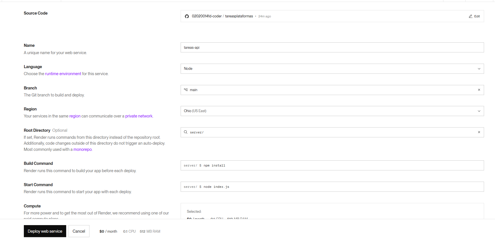
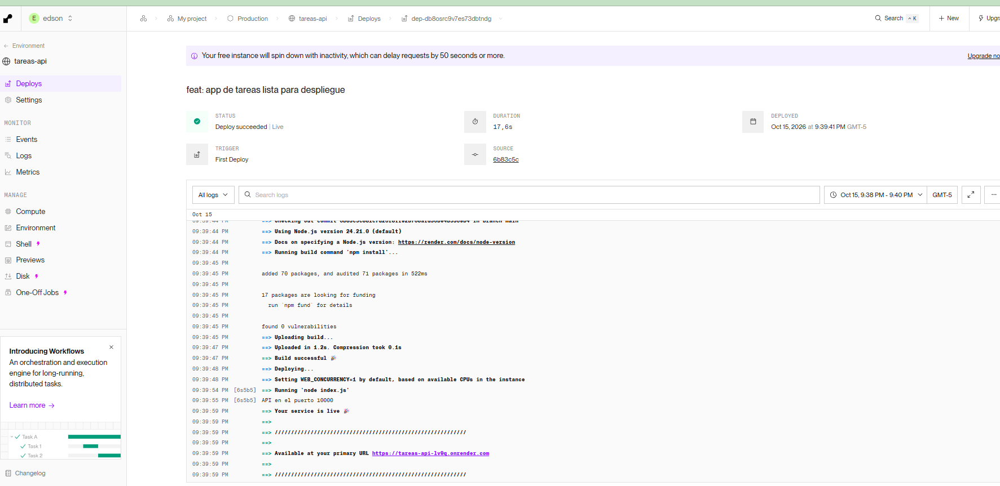
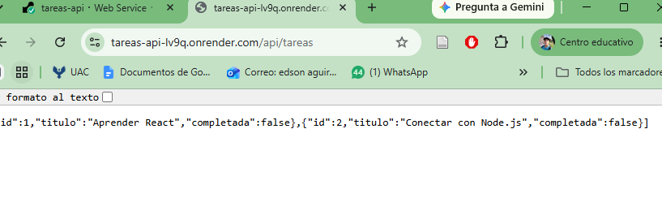
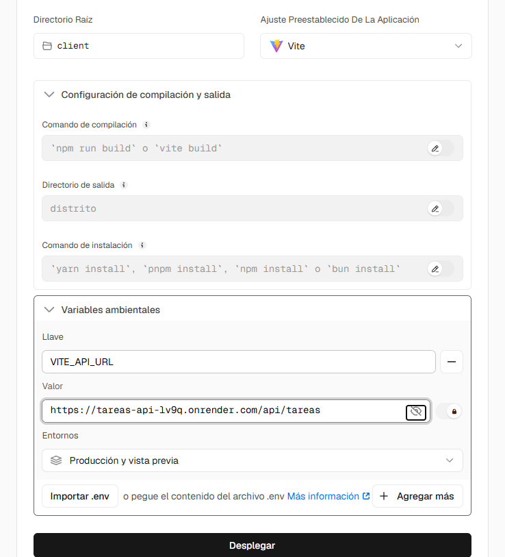
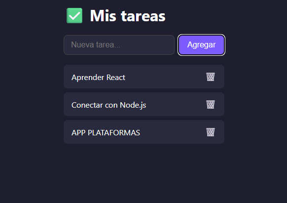
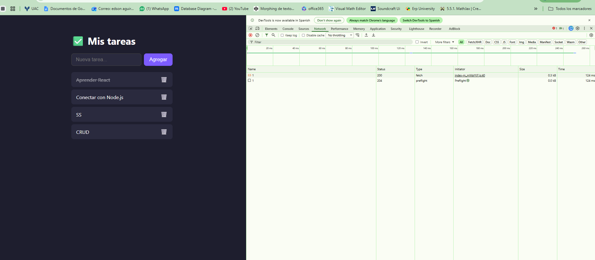
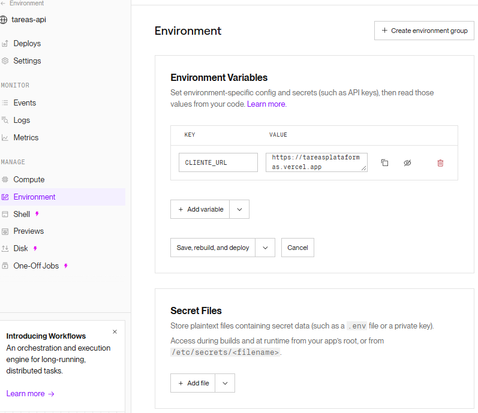

# ✅ App de Tareas — React + Node.js

## Como ejecutar

### 1. Backend
    cd server
    npm install
    npm run dev        # corre en http://localhost:3001

### 2. Frontend (en otra terminal)
    cd client
    npm install
    npm run dev        # corre en http://localhost:5173

Abre http://localhost:5173 en el navegador.

## Endpoints de la API

| Metodo | Ruta               | Descripcion              |
|--------|--------------------|--------------------------|
| GET    | /api/tareas        | Obtener todas las tareas |
| POST   | /api/tareas        | Crear una tarea          |
| PUT    | /api/tareas/:id    | Completar/descompletar   |
| DELETE | /api/tareas/:id    | Eliminar una tarea       |

## Prueba rapida de la API (sin navegador)

    curl http://localhost:3001/api/tareas
    curl -X POST http://localhost:3001/api/tareas -H "Content-Type: application/json" -d '{"titulo":"Mi tarea"}'

## Despliegue

<!-- AGREGADO (Guía 8, entregable): el LEEME.md del docente se renombró a README.md
     sin cambiar su texto; esta sección se añadió para las URLs, variables y capturas. -->

| Parte | Plataforma | URL en vivo |
|-------|------------|-------------|
| Frontend | Vercel | https://tareasplataformas.vercel.app |
| API | Render | https://tareas-api-lv9q.onrender.com/api/tareas |

> La API usa el plan gratuito de Render: si no recibe peticiones durante 15 minutos se duerme y la primera carga puede tardar cerca de un minuto.

### Configuración

| Plataforma | Root Directory | Build | Start / Output |
|------------|----------------|-------|----------------|
| Render (Web Service, Free) | `server` | `npm install` | `node index.js` |
| Vercel (Vite) | `client` | `npm run build` | `dist` |

### Variables de entorno

| Plataforma | Variable | Valor |
|------------|----------|-------|
| Render | `CLIENTE_URL` | `https://tareasplataformas.vercel.app` (CORS restringido al frontend) |
| Vercel | `VITE_API_URL` | `https://tareas-api-lv9q.onrender.com/api/tareas` |

### Capturas

**1. Configuración del Web Service en Render**

**2. Despliegue en Render terminado (Live)**

**3. La API responde JSON en la nube**

**4. Configuración del proyecto en Vercel (Root `client`, Vite y `VITE_API_URL`)**

**5. App en vivo: tarea creada (POST)**

**6. App en vivo: tarea completada (PUT) vista en la pestaña Network**

**7. CORS restringido a la URL de Vercel en Render**

